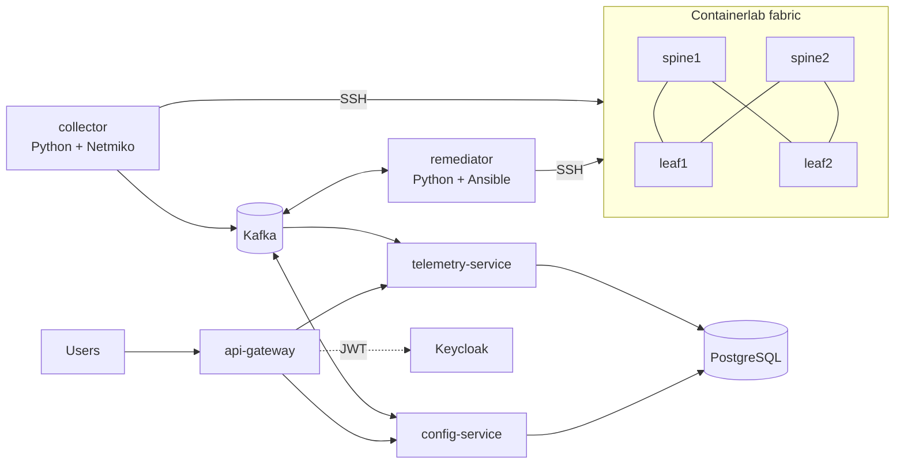

# NetGuard build plan

This is the spec Claude Code works from. CLAUDE.md holds the rules; this file
holds the what and the how. Work through the phases in order.

---

## 1. Goal and scope

NetGuard watches a small BGP lab fabric, detects routing faults and config
drift, and fixes them through an approval-gated remediation flow.

**Must-have (this weekend, phases 0 to 6)**

- Containerlab fabric: 2 spines, 2 leaves, 2 hosts, FRR, eBGP underlay
- Python collector publishing BGP state, interface state and configs to Kafka
- Spring Boot: api-gateway, telemetry-service, config-service, with PostgreSQL
- Keycloak login with VIEWER, OPERATOR and ADMIN roles, four-eyes approval
- Ansible remediation that restores the golden config and verifies BGP recovers
- Docker Compose stack, then Helm on k3d with default-deny NetworkPolicies
- GitHub Actions: build, test, Trivy, SBOM, push images to GHCR
- Prometheus and Grafana dashboards, README with diagram and demo script

**Stretch (later, section 13)**: cloud demo on AKS or EKS, always-on demo host,
VXLAN-EVPN overlay, AI incident summary with the Gemini free tier, ZAP and
OpenTelemetry.

**Out of scope**: a web frontend (Swagger UI and Grafana are the UI), multi-node
Kafka, HA anything, production hardening of Keycloak.

---

## 2. Environment and constraints

### Codespaces (primary)

- 4-core / 16 GB codespace from .devcontainer/devcontainer.json
- GitHub Pro (Student Developer Pack) includes 180 core-hours a month. A 4-core
  machine uses 4 per hour, so about 45 hours a month. Stop the codespace when idle.
- Storage counts while the codespace exists (20 GB-month on Pro). Run
  `docker system prune -f` after heavy builds.

### Lean mode (8 GB laptop demos)

| Piece | Setting | Approx. RAM |
| --- | --- | --- |
| 4 FRR routers, 2 hosts | defaults | 0.3 GB |
| Kafka (KRaft) | KAFKA_HEAP_OPTS=-Xms256m -Xmx256m | 0.5 GB |
| PostgreSQL | shared_buffers=64MB, max_connections=30 | 0.15 GB |
| Keycloak | start-dev, mem_limit 512m | 0.5 GB |
| 4 Spring Boot apps | -XX:+UseSerialGC -XX:MaxRAMPercentage=70, mem_limit 300m | 1.2 GB |
| collector, remediator | mem_limit 128m each | 0.15 GB |
| Prometheus, Grafana | only with the obs profile | 0.3 GB |

Compose profiles:

- `core`: lab-facing pieces, Kafka, Postgres, the three Spring services, collector, remediator
- `auth`: Keycloak (required from Phase 3 on)
- `obs`: Prometheus, Grafana

`make up` starts core + auth. `make up-obs` adds obs.

---

## 3. Architecture



| Component | Job |
| --- | --- |
| collector | Every 10 s, SSH to each router, run vtysh JSON commands, publish to Kafka |
| telemetry-service | Store BGP and interface state, run alert rules, serve alert API |
| config-service | Golden configs, drift detection, approval workflow, audit log |
| api-gateway | Single entry point, JWT validation, routing |
| remediator | Consume approved requests, push golden config with Ansible, verify, report |
| Keycloak | Users and roles |
| PostgreSQL | One DB `netguard`, schemas `telemetry` and `config`, one user per service |

---

## 4. Lab design

Topology file: `lab/topology.clab.yml`, lab name `netguard`.

| Node | Kind / image | ASN | Loopback |
| --- | --- | --- | --- |
| spine1 | linux, netguard/frr-ssh (built from quay.io/frrouting/frr) | 65100 | 10.0.0.1/32 |
| spine2 | same | 65100 | 10.0.0.2/32 |
| leaf1 | same | 65101 | 10.0.0.11/32 |
| leaf2 | same | 65102 | 10.0.0.12/32 |
| host1 | linux, ghcr.io/hellt/network-multitool | n/a | 192.168.11.10/24, gw .1 |
| host2 | same | n/a | 192.168.12.10/24, gw .1 |

| Link | A side | B side | Subnet |
| --- | --- | --- | --- |
| spine1:eth1 to leaf1:eth1 | 10.1.1.0 | 10.1.1.1 | /31 |
| spine1:eth2 to leaf2:eth1 | 10.1.1.2 | 10.1.1.3 | /31 |
| spine2:eth1 to leaf1:eth2 | 10.1.2.0 | 10.1.2.1 | /31 |
| spine2:eth2 to leaf2:eth2 | 10.1.2.2 | 10.1.2.3 | /31 |
| leaf1:eth3 to host1:eth1 | 192.168.11.1 | 192.168.11.10 | /24 |
| leaf2:eth3 to host2:eth1 | 192.168.12.1 | 192.168.12.10 | /24 |

BGP: eBGP on every /31, advertise loopbacks and host subnets,
`bgp bestpath as-path multipath-relax`, `maximum-paths 2` on the leaves so
host1 to host2 uses both spines.

Image `lab/frr-ssh/Dockerfile`: FROM the FRR image, add openssh-server, user
`netguard` with key-only auth and passwordless sudo limited to `vtysh` and
`/usr/lib/frr/frr-reload.py`. Key pair generated by `make lab-keys` into
`lab/.ssh/` (gitignored).

Golden configs: `lab/golden/<device>.frr.conf`, identical to the intended
startup configs in `lab/configs/`.

Management network: default containerlab mgmt network in phases 1 to 3. In
phase 4 the mgmt network must be switchable to the k3d Docker network
(`k3d-netguard`), for example through an environment variable in the topology
file, so pods can reach the routers.

`docs/lab.md` must document demo faults:

1. Shut a BGP neighbor on leaf1 (session down)
2. Bounce an interface repeatedly (flapping)
3. Change a prefix or ASN line on leaf2 by hand (config drift)

---

## 5. Kafka topics and event schemas

All topics: 1 partition, replication 1, key = device name.

| Topic | Producer | Consumer |
| --- | --- | --- |
| telemetry.bgp | collector | telemetry-service |
| telemetry.interface | collector | telemetry-service |
| config.snapshot | collector | config-service |
| alert.events | telemetry-service, config-service | telemetry-service |
| remediation.request | config-service | remediator |
| remediation.result | remediator | config-service |

```json
// telemetry.bgp
{"schemaVersion":1,"device":"leaf1","collectedAt":"2026-11-08T14:00:00Z",
 "peers":[{"peer":"10.1.1.0","remoteAs":65100,"state":"Established",
           "uptimeSec":3600,"prefixesReceived":4}]}

// telemetry.interface
{"schemaVersion":1,"device":"leaf1","collectedAt":"2026-11-08T14:00:00Z",
 "interfaces":[{"name":"eth1","operStatus":"up","rxBytes":1200,"txBytes":900}]}

// config.snapshot (sent when the sha256 changes, plus every 5 minutes)
{"schemaVersion":1,"device":"leaf1","collectedAt":"2026-11-08T14:00:00Z",
 "sha256":"<hex>","config":"<running-config text>"}

// alert.events
{"schemaVersion":1,"alertId":"<uuid>","type":"BGP_SESSION_DOWN",
 "severity":"CRITICAL","device":"leaf1","key":"10.1.1.0",
 "state":"OPEN","details":{},"at":"2026-11-08T14:00:30Z"}

// remediation.request
{"schemaVersion":1,"remediationId":"<uuid>","device":"leaf2","goldenVersion":3,
 "requestedBy":"admin","approvedBy":"operator","approvedAt":"..."}

// remediation.result
{"schemaVersion":1,"remediationId":"<uuid>","status":"SUCCEEDED",
 "diffApplied":"...","log":"...","finishedAt":"..."}
```

---

## 6. Data model (Flyway)

Schema `telemetry` (user `telemetry_svc`):

- bgp_peer_state(device, peer, remote_as, state, uptime_sec, prefixes_received, updated_at), PK (device, peer)
- bgp_peer_event(id, device, peer, from_state, to_state, at)
- interface_state(device, name, oper_status, updated_at), PK (device, name)
- alert(id uuid PK, type, severity, device, key, state, details jsonb, raised_at, resolved_at), one OPEN row per (type, device, key)

Schema `config` (user `config_svc`):

- device(name PK, mgmt_host, asn, role)
- golden_config(id, device, version, content, sha256, created_by, created_at), unique (device, version)
- config_snapshot(device PK, sha256, content, collected_at)
- drift(id, device, golden_version, diff, detected_at, resolved_at)
- remediation(id uuid PK, device, golden_version, status, requested_by, requested_at, approved_by, approved_at, finished_at, result_log)
  status: PENDING, APPROVED, RUNNING, SUCCEEDED, FAILED, REJECTED
- audit_log(id, actor, action, entity_type, entity_id, details jsonb, at)

---

## 7. REST API (through the gateway on port 8080)

| Method and path | Service | Role |
| --- | --- | --- |
| GET /api/devices | config | VIEWER |
| GET /api/devices/{device}/bgp | telemetry | VIEWER |
| GET /api/devices/{device}/interfaces | telemetry | VIEWER |
| GET /api/alerts?state=OPEN | telemetry | VIEWER |
| GET /api/drift | config | VIEWER |
| GET /api/golden/{device} | config | VIEWER |
| PUT /api/golden/{device} (creates a new version) | config | ADMIN |
| GET /api/remediations | config | VIEWER |
| POST /api/remediations {"device":"leaf2"} | config | ADMIN |
| POST /api/remediations/{id}/approve | config | OPERATOR, not the requester |
| POST /api/remediations/{id}/reject | config | OPERATOR |
| GET /api/audit | config | ADMIN |

Errors use RFC 9457 problem+json. Swagger UI is served per service and linked
through the gateway.

---

## 8. Alert rules and drift detection

| Type | Rule | Severity | Resolves when |
| --- | --- | --- | --- |
| BGP_SESSION_DOWN | peer not Established for more than 30 s | CRITICAL | peer Established |
| BGP_FLAPPING | more than 3 exits from Established in 5 min | WARNING | 10 min stable |
| INTERFACE_DOWN | eth1 to eth3 oper down for more than 30 s | CRITICAL | interface up |
| CONFIG_DRIFT | normalized running config differs from latest golden | WARNING | configs match |

Config normalization (unit-tested with fixtures):

1. Drop comment lines (`!`), blank lines, trailing whitespace
2. Drop volatile lines: `frr version`, `frr defaults`, `Building configuration`, `Current configuration`
3. Split into top-level blocks (`router bgp`, `interface X`, and so on)
4. Sort lines inside each block, keep block order irrelevant (compare as a map)
5. Diff output is a unified diff of the normalized text

---

## 9. Security design

- Keycloak realm `netguard` (export in deploy/keycloak/realm-netguard.json),
  client `netguard-api`, roles VIEWER, OPERATOR, ADMIN. Test users `viewer`,
  `operator`, `admin`; passwords generated into .env by `make secrets`.
- Gateway validates JWTs; each service validates them again (defense in depth).
- Method-level checks (`@PreAuthorize`). Approver must differ from requester.
- Every state change writes audit_log with the JWT subject.
- One DB user per service, scoped to its own schema.
- Containers: non-root, read-only root filesystem where possible, no privileged
  mode except the lab routers.
- Kubernetes: PSA "restricted" on the app namespace, one ServiceAccount per
  workload, no secret access, default-deny NetworkPolicy plus explicit allows.
- CI: Trivy fs and image scans fail on CRITICAL, SBOM per image, pinned actions,
  least-privilege workflow permissions.
- `docs/threat-model.md`: a one-page STRIDE table for the gateway, Kafka and the
  remediator.

---

## 10. Observability

Custom metrics (Micrometer / prometheus_client):

- netguard_bgp_sessions{device,state}
- netguard_alerts_total{type}
- netguard_drift_devices
- netguard_remediations_total{status}
- netguard_collector_poll_seconds (histogram)

Grafana dashboard `NetGuard overview`: BGP sessions per device, alerts over time,
drift count, remediation outcomes, HTTP p95 latency per service.

---

## 11. Repo layout

```
netguard/
  CLAUDE.md  Makefile  README.md  .env.example  .gitignore
  .devcontainer/      devcontainer.json, post-create.sh
  docs/               PLAN.md, progress.md, learning.md, lab.md, demo.md, threat-model.md, cloud.md
  lab/                topology.clab.yml, configs/, golden/, frr-ssh/Dockerfile
  collector/          pyproject.toml, netguard_collector/, inventory.yaml, tests/
  remediator/         pyproject.toml, netguard_remediator/, ansible/, tests/
  services/           pom.xml, common/, api-gateway/, telemetry-service/, config-service/
  deploy/
    compose/          docker-compose.yml
    keycloak/         realm-netguard.json
    observability/    prometheus.yml, grafana/
    helm/netguard/
    k3d/              k3d-config.yaml
  infra/terraform/    envs/dev/, modules/vpc/, modules/eks/
  scripts/            demo.sh
  .github/workflows/  ci.yml
```

---

## 12. Phases

Each phase: plan mode first, wait for approval, build, run the checks, record
them in docs/progress.md, update docs/learning.md, stop and report.

### Phase 0: scaffold (about 30 min)

- Repo layout from section 11, Makefile with all targets (stubs allowed)
- `make doctor` prints versions of docker, containerlab, java, mvn, python3,
  k3d, kubectl, helm, terraform, aws, ansible, trivy, gh, jq and flags missing ones
- .gitignore: .env, *.tfstate*, .terraform/, clab-*/, lab/.ssh/, target/,
  __pycache__/, .venv/
- .env.example, docs/progress.md, docs/learning.md

Done when: `make doctor` is all green and the first commit exists.

### Phase 1: lab and collector (about 1.5 h)

- Lab exactly as section 4, plus `make lab-keys`, `lab-up`, `lab-down`
- Single Kafka (KRaft) in Compose for now
- Collector: Netmiko over SSH, commands
  `vtysh -c 'show bgp summary json'`, `vtysh -c 'show interface json'`,
  `vtysh -c 'show running-config'`; poll every 10 s; publish per section 5;
  `--dry-run` prints instead of publishing; JSON logs; reconnect with backoff
- pytest with saved sample outputs in collector/tests/fixtures/
- docs/lab.md with the demo faults

Done when:

1. `make lab-up` then `docker exec clab-netguard-leaf1 vtysh -c "show bgp summary"` shows 2 Established peers
2. `docker exec clab-netguard-host1 ping -c 3 192.168.12.10` succeeds
3. A console consumer on telemetry.bgp shows messages
4. `pytest` passes in collector/

### Phase 2: Spring Boot services (about 3 h)

- Maven multi-module per section 11, `common` holds event records
- Flyway schemas per section 6, separate DB users
- telemetry-service: consumers, state tables, alert rules (section 8), alert.events producer, API (section 7)
- config-service: seed devices and golden v1 from lab/golden at startup, consume config.snapshot, normalization and drift (section 8), remediation endpoints (no auth yet), audit_log
- api-gateway: Spring Cloud Gateway routes per section 7
- springdoc OpenAPI, Actuator health and prometheus endpoints
- Unit tests for alert rules and normalization; Testcontainers tests for Kafka and Postgres
- All in Compose with the memory limits from section 2

Done when:

1. `./mvnw verify` passes
2. `make up` starts everything and Swagger UI loads through the gateway
3. Demo fault 1 gives a BGP_SESSION_DOWN alert in /api/alerts within about 40 s
4. Demo fault 3 shows leaf2 in /api/drift

### Phase 3: security and remediation (about 2 h)

- Keycloak per section 9 (auth profile), `make secrets`
- Resource server config in gateway and services, role checks, four-eyes rule
- Remediator: consume remediation.request, run `remediator/ansible/push_golden.yml`
  (copy golden config, `frr-reload.py --reload`, poll until all peers Established,
  timeout 90 s), publish remediation.result; config-service updates status and audit
- problem+json errors, input validation, no stack traces
- `make scan` = Trivy fs scan, fail on CRITICAL
- docs/threat-model.md

Done when:

1. No token returns 401; viewer approving returns 403; admin approving own request is rejected
2. Full loop: demo fault 3, drift appears, admin requests, operator approves, Ansible runs, drift clears, BGP Established
3. audit_log shows every step with the right user
4. `make scan` reports no CRITICAL

### Phase 4: Kubernetes on k3d (about 2 h)

- `make down` first. Single-node k3d cluster `netguard`, Traefik disabled
- Switch the lab mgmt network to `k3d-netguard` so pods reach the routers;
  if that fails, run collector and remediator outside the cluster and document why
- Helm chart deploy/helm/netguard: services, collector, remediator, Kafka
  StatefulSet, Postgres StatefulSet, Keycloak; same memory limits; obs optional
- Security per section 9; secrets created from .env by a make target
- Gateway exposed with `kubectl port-forward`; images loaded with `k3d image import`

Done when:

1. All pods Running and Ready in namespace netguard
2. A test pod without allow labels cannot reach Postgres or Kafka (policy enforced)
3. `kubectl auth can-i list secrets --as=system:serviceaccount:netguard:<sa>` is "no" for each workload
4. The Phase 3 loop works through the port-forward

### Phase 5: CI/CD and Terraform (about 1.5 h)

- .github/workflows/ci.yml on PRs and pushes to main: Maven verify, ruff +
  pytest, helm lint, terraform fmt -check + validate, Buildx images for
  linux/amd64 and linux/arm64, Trivy image scans (fail on CRITICAL), SBOM
  artifacts, push to GHCR on main only with GITHUB_TOKEN; pinned actions;
  least-privilege permissions
- Terraform for AWS: modules/vpc (2 AZs, public subnets, no NAT gateway,
  documented), modules/eks (managed node group, 2 small instance types allowed
  on the AWS Free plan), envs/dev, kubeconfig output, local gitignored state
- docs/cloud.md: deploying the same chart to AKS Free tier on Azure for Students
- Run only `terraform init -backend=false` and `terraform validate`. No plan, no apply, no cloud accounts.

Done when:

1. CI green on GitHub, images in GHCR (I make packages public)
2. `terraform validate` passes
3. `git log -p | grep -iE "password|secret|api_key"` shows only placeholders

### Phase 6: observability, README, demo (about 1.5 h)

- Metrics and dashboard per section 10, provisioned in Compose (obs profile) and Helm
- scripts/demo.sh: break leaf2, wait for alert and drift, admin requests, operator
  approves, wait for recovery; prints each step with timestamps
- README: problem, Mermaid architecture, stack, quick start (make targets),
  demo walkthrough, security design summary, lean mode notes, what's next,
  placeholders for screenshots and a demo GIF

Done when:

1. `make up-obs && make demo` shows the drop and recovery on the dashboard
2. A fresh clone plus the README quick start brings the stack up

---

## 13. Stretch phases (later, one per evening)

- S1 Cloud demo: AKS Free tier on Azure for Students or EKS on a new AWS Free
  plan account. Add a collector replay mode that publishes recorded telemetry
  (the lab cannot run there). I run plan/apply and destroy the same day.
- S2 Always-on demo: Oracle Always Free Arm VM with k3s.
- S3 VXLAN-EVPN: L2VNI between host1 and host2, collector adds `show evpn vni json`.
- S4 AI incident summary: Spring AI with the Gemini API free tier (Flash model),
  RAG over docs/runbooks in pgvector, GET /api/alerts/{id}/explain. Only lab data
  is sent to the API.
- S5 OWASP ZAP baseline scan in CI, OpenTelemetry tracing across services.

---

## 14. How I will drive this

First message in a fresh Claude Code session:

> Read CLAUDE.md and docs/PLAN.md. We are starting Phase 0. Enter plan mode and
> show me the plan.

Every later phase:

> Read CLAUDE.md, docs/PLAN.md and docs/progress.md. Start Phase N. Plan mode first.

After each phase:

> Explain what you built in Phase N the way an interviewer would question me on it.
